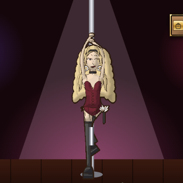
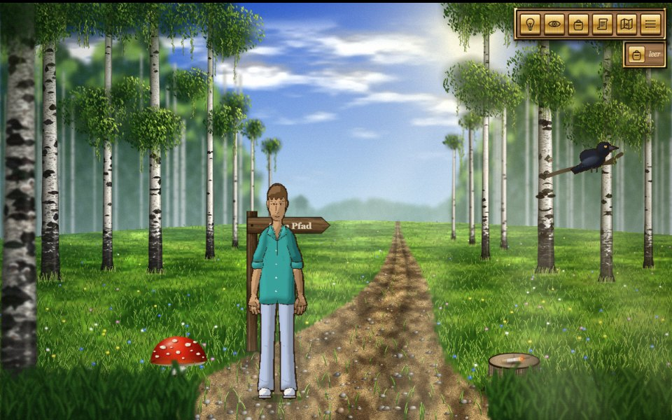
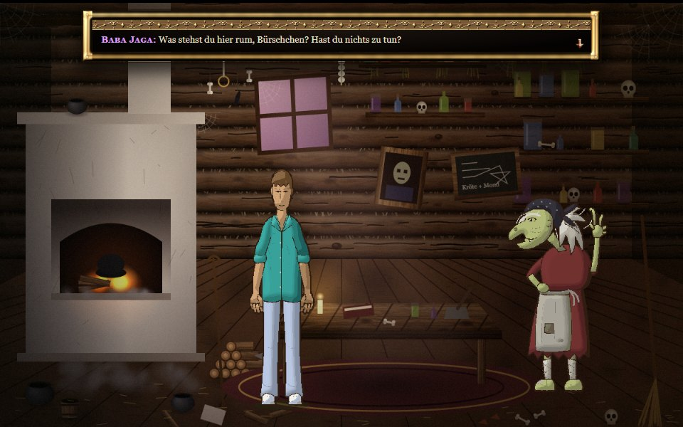
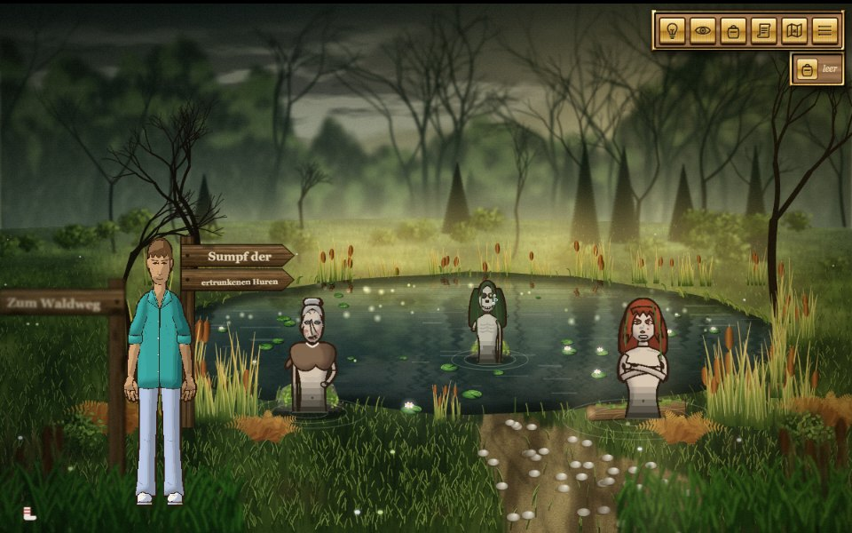
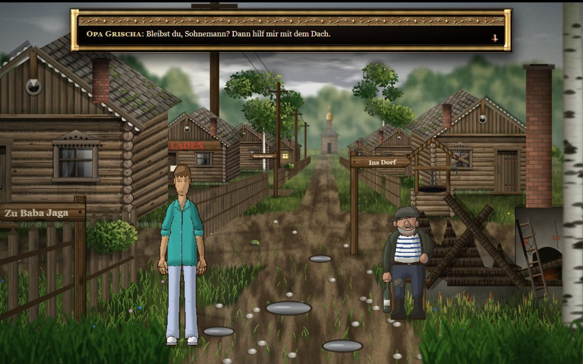
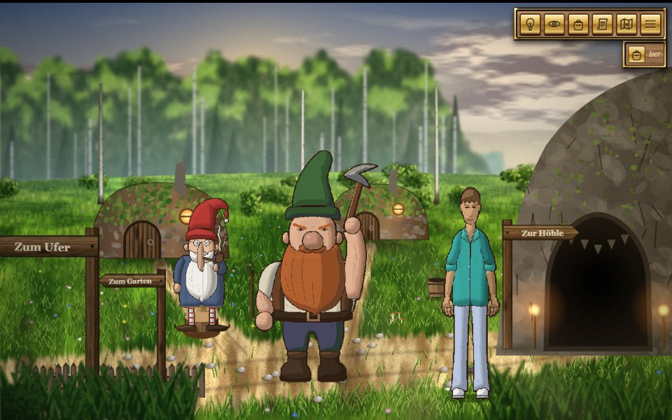
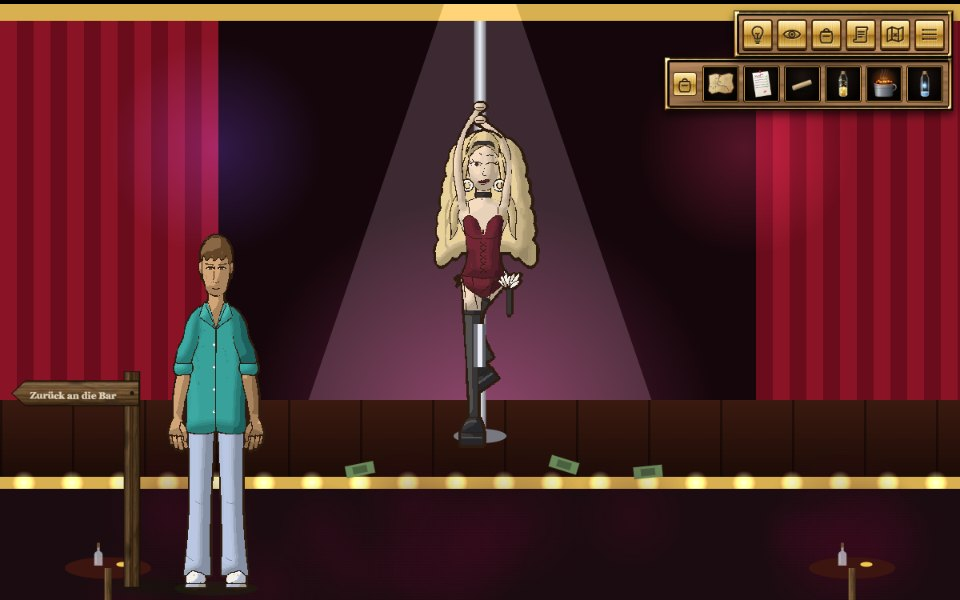

# Petja und der Verfluchte Birkenwald

**A trashy point-and-click adventure in the spirit of early-2000s Russian adventure games — runs right in your browser.**
Deutsch · English · Русский

### ▶ [Play now in your browser](https://yarak5113-alt.github.io/Petja-quest/)

No download, no install, no account. Works in any current desktop browser (Chrome, Edge, Firefox, Safari). Progress is saved in your browser.

<p align="center"></p>

---

## ⚠️ Content warning / Inhaltswarnung

This is a **comedy game for adults (16+/18+)**. It contains:

- **crude slang and swearing** (German, English and Russian street talk)
- **drug humour**: the plot starts with a bad joint and is about getting home again
- **alcohol**: moonshine, vodka and a lot of hangovers
- **suggestive scenes**: a burlesque club, private dances and a VIP booth, with lingerie and flirting but **no nudity**
- **dark fairy-tale humour**: skulls, a witch's kitchen, drowned swamp nymphs

Everything is meant as satire. If that's not your thing, this game isn't for you.

> **DE:** Derber Humor für Erwachsene: Slang und Flüche, Drogen- und Alkoholwitze, anzügliche Szenen in einem Burlesque-Club (Dessous und Flirt, keine Nacktheit) und schwarzer Märchenhumor.

---

## What's it about?

Petja, a lazy guy from the suburbs, smokes a joint his mate Wowa gave him on a Saturday afternoon. He wakes up in a cursed birch forest straight out of a Russian fairy tale. To get home he has to deal with:

- Baba Yaga
- gnomes demanding a toll
- a fisherman whose moonshine he steals
- a granny who has lost her dentures
- a burlesque club in the middle of the forest

Along the way he has to roll a new **"way-out joint"**.

- **3 endings.** Go home, stay forever as a cog in the fairy tale, or the secret Nastja ending.
- **Side quest.** Recruit a second dancer for Madame Zinaida's club.
- **Relationship system.** Characters remember what you did, in RDR2 style.
- **Minigames.** Fishing, sawing, house-building, mushroom picking.
- **Hidden things.** Easter eggs and achievements.
- **3 languages.** Each has its own jokes and references, not just a literal translation.

## Screenshots

| | |
|---|---|
|  |  |
|  |  |
|  |  |

## Controls / Steuerung

| Input | Action | Aktion |
|---|---|---|
| **Left click** | Walk, look, use, talk | Laufen, ansehen, benutzen, sprechen |
| **Click / right-click an item** | Examine (Petja comments) | Untersuchen (Petja kommentiert) |
| **Drag an item** | onto another item: combine · onto a character/object: use | auf Gegenstand: kombinieren · auf Figur/Ding: benutzen |
| **Click / Space in dialogue** | Next line | Text weiter |
| **Esc / right-click in dialogue** | Skip conversation | Gespräch überspringen |
| **Hold Space** | Show everything clickable | Alles Klickbare zeigen |
| **H** | Hint: what should I do next? | Tipp: Was als Nächstes? |
| **I / J / M** | Pockets / quests / map | Taschen / Aufträge / Karte |
| **C / L** | Characters and their conversations | Figuren und ihre Gespräche |
| **Mouse wheel / drag on the map** | Zoom / move the map | Karte zoomen / verschieben |
| **Map click** | Fast travel (after 5 discovered places) | Schnellreise (ab 5 entdeckten Orten) |
| **V** | Voices on/off | Stimmen an/aus |
| **F** | Fullscreen | Vollbild |
| **Esc** | Menu (save, load, settings, achievements) | Menü (Speichern, Laden, Einstellungen, Erfolge) |

Language: on the title screen (DE · EN · RU) or in **Menu → Settings**.

## Run it locally

It's plain HTML/CSS/JavaScript with no build step and no dependencies:

```bash
git clone https://github.com/yarak5113-alt/Petja-quest.git
cd Petja-quest
# just open index.html – or serve the folder, e.g.:
npx serve .
```

## Tech notes

- Every background is painted procedurally on a `<canvas>`. The characters are pixel-art sprites, stored as JSON arrays in `pixel/`.
- Ambient sound and music are synthesised live with the Web Audio API, so there are no audio files.
- Translations live in `lang/src/<en|ru>/*.txt` and are built with `node tools/i18n-bau.js`.
- `node tools/durchlauf.js` plays the whole game automatically in headless Edge, as a regression test.
